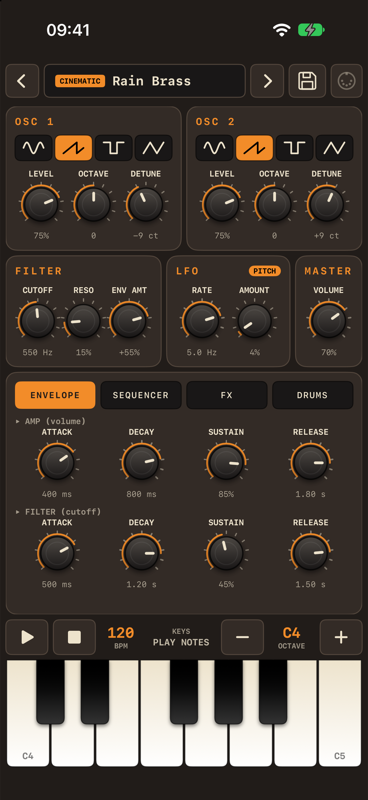
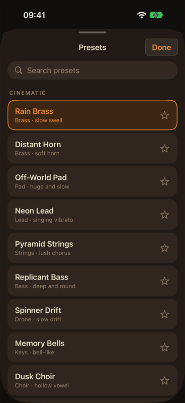
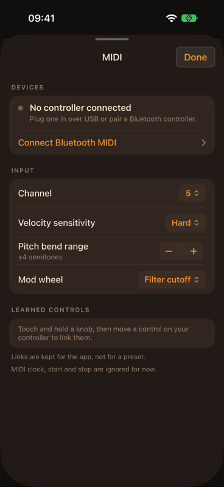

# Ember One

An analog-style synthesizer for iPhone with a step sequencer, drum machine, presets and MIDI support.

## Screenshots

| | | |
|:---:|:---:|:---:|
|  |  |  |
| Main screen | Presets | MIDI |

## Features

- Two oscillators (sine, saw, square, triangle) with level, octave and detune
- Low-pass filter with resonance and envelope amount
- LFO for pitch or filter cutoff
- Amp and filter envelopes
- FX: chorus, delay, reverb, drive and pump
- 16-step sequencer with banks A–H, key mode (transpose, arpeggiator), hold and a Randomize button
- Drum machine with ten synthesised drums (kick, snare, clap, hats, toms, rim, cowbell, ride), sound variants, banks A–H and Randomize for patterns and sounds
- Presets with categories, favorites and search; your own presets can include the drums
- MIDI controller support (USB, Bluetooth and Wi-Fi network MIDI) with MIDI learn
- Sync to external MIDI clock (tempo, start and stop), e.g. from Ableton Live
- Full-width keyboard in landscape

## Requirements

- Xcode 27
- iOS 26 or later

## How to run

1. Open `MyApp.xcodeproj` in Xcode.
2. Choose an iPhone or a simulator as the run destination.
3. Press Run.

## Built with

SwiftUI and AVAudioEngine.
